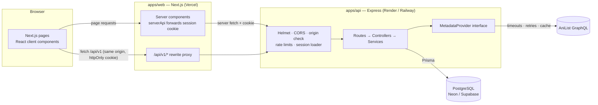
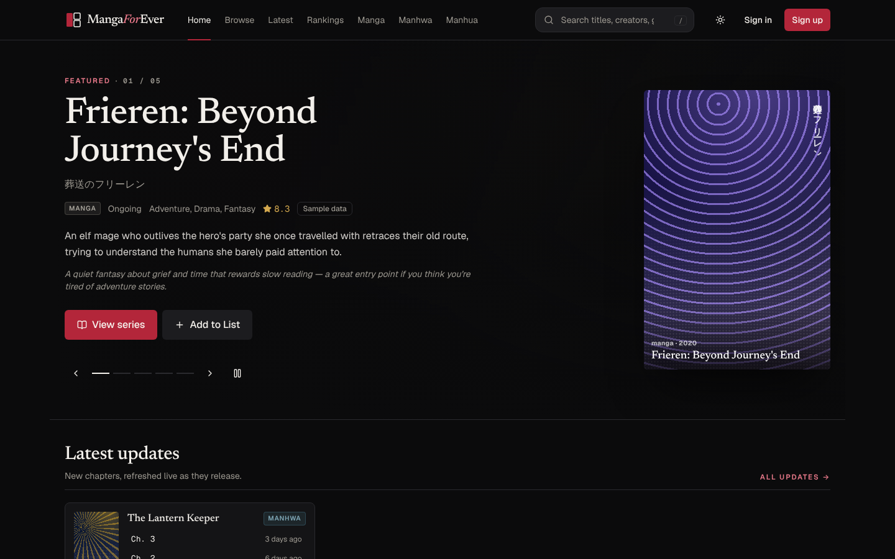
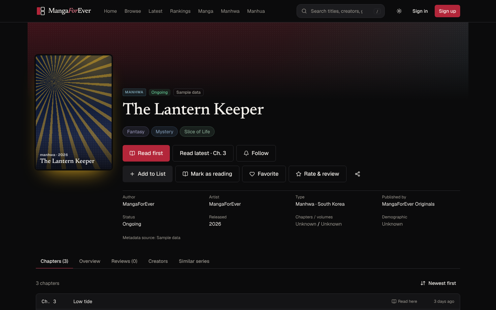
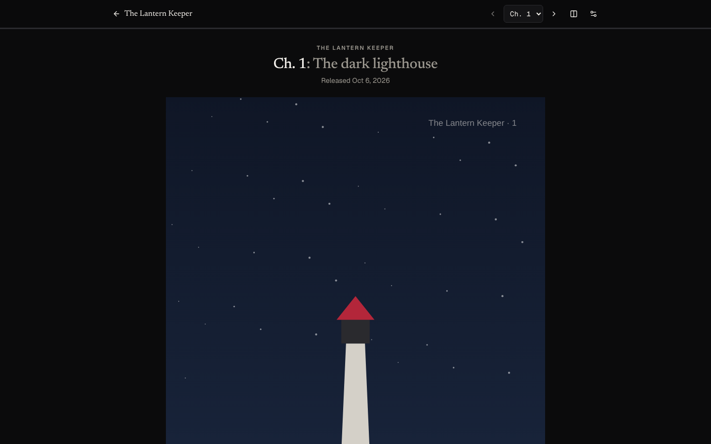
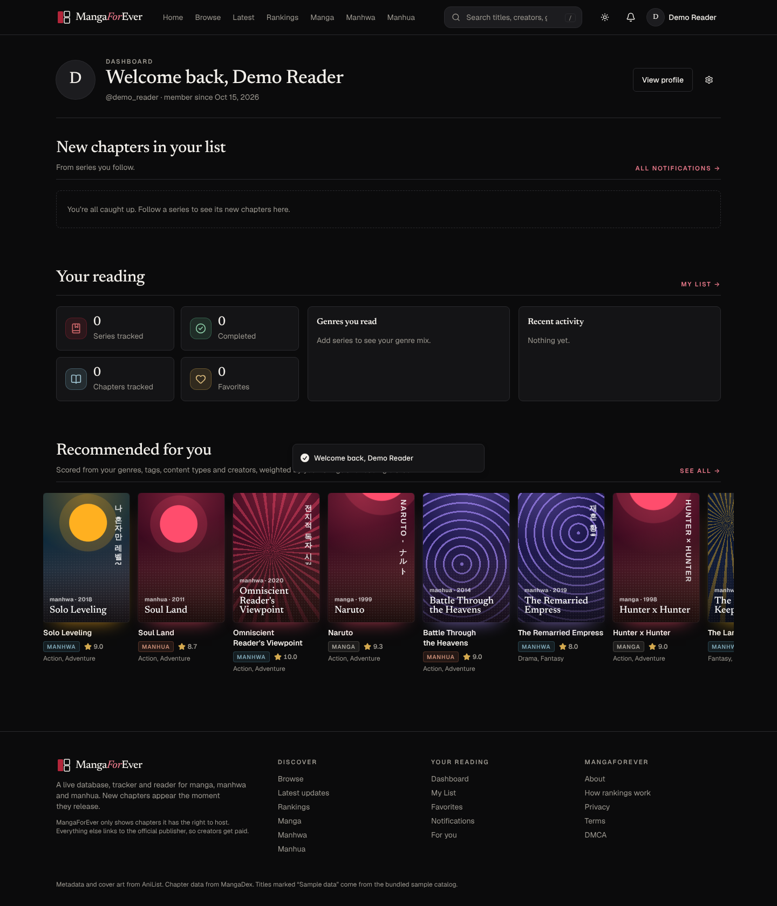
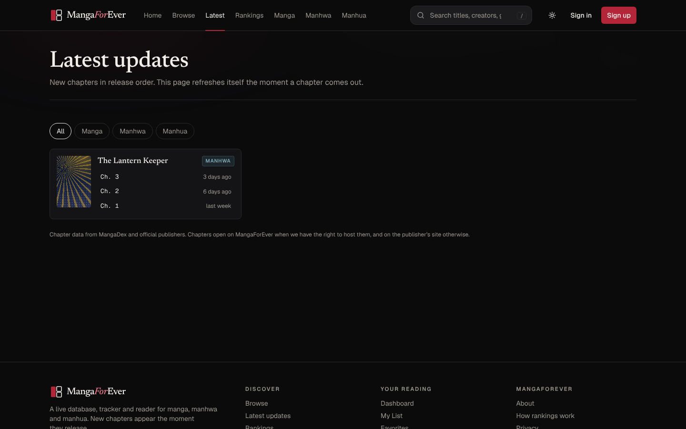
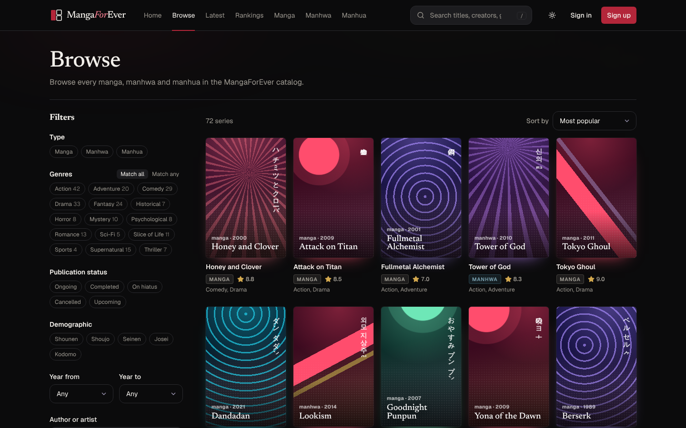
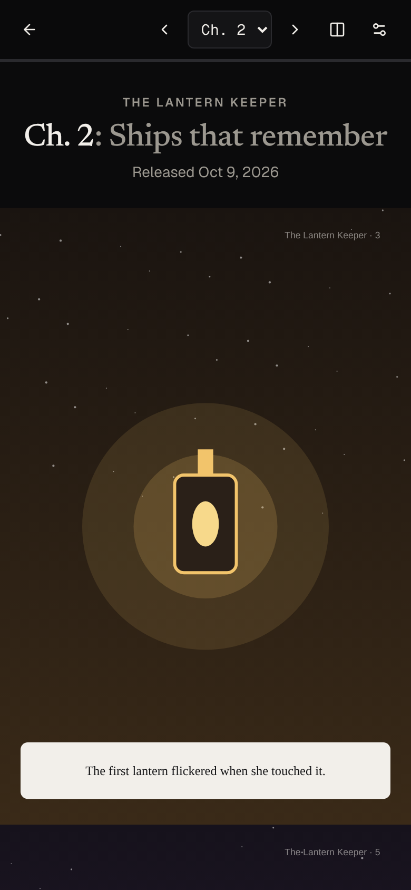

# MangaForEver

**Discover. Track. Review. Explore.**

MangaForEver is a full-stack discovery, tracking and review platform for Japanese manga, Korean manhwa and Chinese manhua. Browse and search a real PostgreSQL-backed catalog of popular series imported from [AniList](https://anilist.co) (with their real cover art), keep a reading library with chapter progress, favorite and rate series, write reviews, and get recommendations that explain why each pick is there.

The catalog keeps itself current: scheduled jobs (free, on GitHub Actions) pick up new chapters every 15 minutes, refresh metadata daily and re-curate the home page, and followers get a live in-app update, a push notification or an opt-in email digest.

**Chapters come only from legal sources.** MangaForEver hosts pages only for works it has the right to show (originals, creator submissions, public-domain and Creative Commons works). Every other chapter opens its official publisher (MANGA Plus, WEBTOON, Tapas and others). It never scrapes or links to scan sites.

---

## Contents

- [Features](#features)
- [Tech stack](#tech-stack)
- [Architecture](#architecture)
- [Getting started](#getting-started)
- [Environment variables](#environment-variables)
- [Database, migrations and seed data](#database-migrations-and-seed-data)
- [Real catalog from AniList](#real-catalog-from-anilist)
- [Website edition](#website-edition)
- [Testing](#testing)
- [API documentation](#api-documentation)
- [Deployment](#deployment)
- [Data honesty rules](#data-honesty-rules)
- [Screenshots](#screenshots)
- [Known limitations and future work](#known-limitations-and-future-work)

---

## Features

| Area | What works |
| --- | --- |
| **Catalog** | Manga / manhwa / manhua with alternative and native titles, creators, genres, tags, demographic, status, dates, chapter/volume counts (unknown stays unknown). |
| **Search** | PostgreSQL full-text ranking + `pg_trgm` trigram matching (GIN-indexed) over titles, native titles, creators, genres and tags. Debounced autocomplete with cover thumbnails, keyboard navigation and `/` shortcut. Typos and partial words work ("berzerk", "solo lev"). |
| **Browse** | Filters for type, multiple genres (match all/any), tags, status, demographic, year range, author/artist, minimum rating, popularity and recently updated; 8 sort orders; accessible link-based pagination. |
| **Series pages** | Shareable `/manga/[slug]` pages with overview, chapters (provider data only), reviews, creators and similar series. Community vs. external ratings are shown separately with sources. |
| **Chapter updates** | New-chapter information from MangaDex's public API (every 15 minutes for followed series first), official-publisher links from AniList, a live "Latest updates" feed (server-sent events with polling fallback), NEW tags, follower notifications in-app, by Web Push and by daily email digest. |
| **Reader** | `/manga/[slug]/chapter/[n]`: long-strip and page-by-page modes (right-to-left for manga), fit and gap settings, keyboard, tap and swipe navigation, auto-hiding toolbar, progress saved to My List automatically, chapter reactions and moderated comments. Official chapters open the publisher with progress still tracked. |
| **Install as an app** | Web app manifest, icons and a service worker with an offline page, so phones can add MangaForEver to the home screen. |
| **Accounts** | Register with email confirmation (Resend), sign in/out, forgot/reset password (single-use, 1-hour tokens), change password, roles (User / Moderator / Admin). Server-side sessions in httpOnly cookies. |
| **Library** | Five reading statuses, chapter + volume progress (validated against known totals only), personal score, private notes, start/finish dates, per-entry privacy, quick “+1 chapter”, dashboard with status counts, chapters tracked, genre mix and recent activity. |
| **Favorites** | Toggle anywhere; dedicated page with type/genre filters and four sort orders. |
| **Ratings & reviews** | 1–10 ratings (create/update/remove), averages computed from stored rows, one review per member per series, spoiler masking, helpful votes (one per member, no self-votes), reporting. |
| **Moderation** | Report queue; documented actions (hide, restore, dismiss); every action audit-logged. |
| **History** | Recently viewed series, recent searches, reading-activity log; remove single entries or clear; tracking switches for browsing and search. |
| **Recommendations** | Explainable content-based scoring with diversity re-ranking, “Because you read…”, “Similar to your favorites”, “Popular in your genre”, dismiss/refresh, and a new-user fallback. |
| **Discovery** | Editor’s-pick hero carousel, Top 10 with type tabs, trending, highest-rated, most-reviewed, most-favorited, latest catalog updates, newly published vs. newly added, editor-curated seasonal collections. |
| **Community** | Public profiles with privacy controls, follow/unfollow, activity feed, recent reviews feed. |
| **Admin** | Scheduled-job status with "run now", hosted-chapter publishing, manual MangaDex linking for unmatched series, held-comment queue, live statistics dashboard, catalog CRUD + archive, duplicate detection and merge, AniList import/refresh, featured picks, seasonal collections, user roles/suspension, audit log. |
| **UX** | Dark theme by default with persistent light/system themes (synced to the account), responsive layouts, skeleton loaders, empty/error/retry states, keyboard focus styles, reduced-motion support. |

## Tech stack

- **Web:** Next.js 16 (App Router) · React 19 · TypeScript · Tailwind CSS 4 · shadcn-style components on Radix primitives · Lucide icons · React Hook Form + Zod · next-themes · Sonner
- **API:** Node.js · Express 5 · TypeScript · Zod validation · Helmet · express-rate-limit · Pino · Swagger UI (OpenAPI 3.1)
- **Database:** PostgreSQL · Prisma 7 (driver adapter `@prisma/adapter-pg`) · `pg_trgm`
- **Shared:** `@mangaforever/shared` — Zod schemas, enums and DTO types used by both apps
- **Metadata:** AniList GraphQL API behind a replaceable provider interface
- **Tests:** Vitest + Supertest integration tests against a real PostgreSQL database

## Architecture



The browser only ever talks to the web origin; Next.js proxies `/api/v1/*` to the API, so the session cookie is first-party and `SameSite=Lax` works across the Vercel ↔ Render split. More detail, including the data model, ranking formulas and the recommendation algorithm, is in [`docs/architecture.md`](docs/architecture.md).

```
MangaForEver/
├── apps/
│   ├── api/                 Express API
│   │   ├── src/
│   │   │   ├── config/      env validation
│   │   │   ├── controllers/ HTTP ↔ service glue
│   │   │   ├── docs/        OpenAPI document
│   │   │   ├── lib/         prisma client, errors, logger, utils
│   │   │   ├── middleware/  auth, validation, security, errors
│   │   │   ├── providers/   AniList provider, registry, importer
│   │   │   ├── routes/      route table (/api/v1)
│   │   │   └── services/    business logic (+ recommendation/)
│   │   └── test/            Vitest + Supertest suites
│   └── web/                 Next.js app (src/app, src/components, src/lib)
├── packages/shared/         Zod schemas, enums, DTO types
├── prisma/
│   ├── schema.prisma
│   ├── migrations/
│   ├── seed.ts
│   └── seed-data/           labelled sample catalog, picks, collections, demo reviews
├── docs/                    architecture.md, api.md
├── scripts/                 local.mjs (one-command runner), test-DB helpers
├── start-mangaforever.cmd     Windows double-click launcher
├── docker-compose.yml       local PostgreSQL
├── render.yaml              API blueprint
└── .env.example
```

## Getting started

### Quickest: one command, no database install

**Windows:** double-click **`start-mangaforever.cmd`**. The first run downloads a portable Node.js if you don't have Node 20.19+, installs dependencies, sets up a private PostgreSQL inside the project folder (`.local-db`), loads the sample data, builds the app and opens **http://localhost:3000**. Later runs start in seconds. Keep the window open while you use the app; close it (or press Ctrl+C) to stop.

**macOS / Linux / Windows terminal:**

```bash
npm install
npm run local        # production build + start   (npm run local:dev for hot reload)
```

On the first run the launcher also links the sample titles to AniList and imports the most popular manga, manhwa and manhua from the AniList database (about a minute; skipped if you're offline, and the app works without it).

`scripts/local.mjs` uses the [`embedded-postgres`](https://github.com/leinelissen/embedded-postgres) package (real PostgreSQL 18 binaries from npm) on port 5433, binds the API and web app to 127.0.0.1, writes logs to `./logs`, and creates `.env` for you on first run. Delete `.local-db` to start over with a fresh database.

### Manual setup

**Requirements:** Node.js 20.19+ (22 recommended), npm 10+, and PostgreSQL 14+ (Docker works).

```bash
# 1. Install (also builds the shared package and generates the Prisma client)
npm install

# 2. Configure
cp .env.example .env            # defaults work with the docker-compose database

# 3. Start PostgreSQL (or point DATABASE_URL at Neon/Supabase/your own server)
docker compose up -d

# 4. Create the schema and load sample data
npm run db:deploy               # apply migrations
npm run db:seed                 # sample catalog, demo community, staff accounts

# 5. Run API (http://localhost:4000) and web (http://localhost:3000) together
npm run dev
```

Sign in with the seeded accounts (change these in `.env` before seeding anything public):

| Account | Email | Password |
| --- | --- | --- |
| Admin | `admin@mangaforever.local` | `ChangeMe-Admin-1` |
| Moderator | `moderator@mangaforever.local` | `ChangeMe-Mod-1` |
| Demo reader | `reader@mangaforever.local` | `DemoReader-1` |

Or register a new account. Password-reset emails are printed to the API console in development (look for 📧) — plug a real provider into `apps/api/src/services/mailer.ts` for production.

To pull real titles and cover art, sign in as admin → **Admin → Import** → search AniList or import the 25 most popular titles.

Useful scripts:

| Command | What it does |
| --- | --- |
| `npm run local` / `npm run local:dev` | Everything incl. a private PostgreSQL — no setup (see above) |
| `npm run dev` | API + web in watch mode (bring your own PostgreSQL) |
| `npm run build` | Production build of every workspace |
| `npm run start:api` / `npm run start:web` | Run the production builds |
| `npm run db:migrate` | Create/apply a migration after editing `schema.prisma` |
| `npm run db:deploy` | Apply pending migrations (CI / production) |
| `npm run db:seed` | Load or refresh the sample data (idempotent) |
| `npm run db:reset` | Drop, re-migrate and re-seed the dev database |
| `npm run db:test:prepare` | Apply migrations to `TEST_DATABASE_URL` |
| `npm test` | API test suite |
| `npm run typecheck` | Type-check all workspaces |

## Environment variables

All variables live in one root `.env` (see [`.env.example`](.env.example)). The API validates its environment at startup and refuses to boot with a bad configuration.

| Variable | Used by | Purpose |
| --- | --- | --- |
| `DATABASE_URL` | API, Prisma | PostgreSQL connection string |
| `TEST_DATABASE_URL` | tests | Separate database for tests (truncated on every run) |
| `PORT` | API | Port (default 4000) |
| `NODE_ENV` | both | `development` / `production` / `test` |
| `WEB_ORIGIN` | API | Comma-separated origins allowed for CORS and the CSRF origin check |
| `APP_URL` | API | Public web URL used in password-reset links |
| `SESSION_TTL_DAYS` | API | Session lifetime (sliding) |
| `COOKIE_SECURE`, `COOKIE_DOMAIN` | API | Cookie overrides (Secure is automatic in production) |
| `TRUST_PROXY` | API | Number of proxies in front of the API (2 behind Render + Vercel) |
| `METADATA_PROVIDER` | API | `anilist` or `none` |
| `ANILIST_API_URL` | API | AniList GraphQL endpoint |
| `INTERNAL_API_TOKEN` | both | Shared secret so server-side rendering isn't throttled by the per-IP global limit |
| `LOG_LEVEL` | API | Pino log level |
| `API_URL` | web | Where Next.js reaches the API |
| `NEXT_PUBLIC_API_URL` | web | Public API URL (Swagger link) |
| `SITE_URL` | web | Public site address for links, sitemap and social previews (Vercel's address is used automatically) |
| `REQUIRE_EMAIL_VERIFICATION` | API | New accounts must confirm their email before signing in (default `true`) |
| `ADMIN_EMAILS` | API | Comma-separated emails that always get the Admin role |
| `RESEND_API_KEY`, `MAIL_FROM` | API | Email delivery through Resend (logged to the console when unset) |
| `JOBS_TOKEN` | API, GitHub Actions | Secret for `POST /internal/jobs/<job>` |
| `CHAPTER_PROVIDER`, `MANGADEX_API_URL`, `CHAPTER_LANGUAGES` | API | New-chapter source (`mangadex` or `none`) and languages |
| `VAPID_PUBLIC_KEY`, `VAPID_PRIVATE_KEY`, `VAPID_SUBJECT` | API | Optional Web Push keys (`npx web-push generate-vapid-keys`) |
| `SEED_*` | seed | Staff and demo account credentials |

## Database, migrations and seed data

The Prisma schema (`prisma/schema.prisma`) separates **global catalog data** (`MangaSeries`, `Creator`, `Genre`, `Tag`, join tables, `ChapterMetadata`, `FeaturedSeries`, `SeasonalCollection*`) from **private user data** (`LibraryEntry`, `Favorite`, `Rating`, `Review`, `ReviewHelpfulVote`, `ReviewReport`, `ReadingHistory`, `ReadingActivity`, `SearchHistory`, `DismissedRecommendation`, `UserPreference`, `Follow`), plus `Session`, `PasswordResetToken` and `AdminAuditLog`.

Integrity is enforced in the database, not just the app: unique constraints on `(userId, seriesId)` for library entries, favorites, ratings, reviews and history; unique `(externalProvider, externalId)` to stop duplicate imports; foreign keys with cascade/restrict/set-null chosen per relation; and GIN trigram indexes for search. Authors and artists share one `Creator` table — their role on each series lives on `SeriesCreator` (`STORY`, `ART`).

The **seed** loads 71 real series as a clearly labelled *sample catalog* (`source = SEED_SAMPLE`, shown as “Sample data” in the UI), staff accounts, a demo reader, 12 flagged demo members whose library/rating/favorite activity gives the rankings something to rank, 10 demo reviews, 5 editor's picks and 4 editor-curated seasonal collections. Synopses are original summaries; publication status is a snapshot and may be outdated. Sample titles are linked to their AniList entries (next section) so they show AniList's cover art; any series without a cover gets a generated one, coloured by its genres.

Example queries the API runs (see `apps/api/src/services/catalog.service.ts`):

```sql
-- Ranked search: full-text rank + trigram similarity, served by GIN indexes
SELECT id,
  ts_rank(to_tsvector('simple', "searchText"), websearch_to_tsquery('simple', $1)) * 2
  + similarity(lower(title), $1) * 3 + word_similarity($1, "searchText") AS score
FROM "MangaSeries"
WHERE "isArchived" = false
  AND ("searchText" ILIKE '%' || $1 || '%'
       OR to_tsvector('simple', "searchText") @@ websearch_to_tsquery('simple', $1)
       OR $1 <% "searchText" OR title % $1)
ORDER BY score DESC;

-- Possible duplicate titles for the admin merge tool
SELECT a.id, b.id, similarity(lower(a.title), lower(b.title)) AS sim
FROM "MangaSeries" a JOIN "MangaSeries" b
  ON a.id < b.id AND a.type = b.type AND lower(a.title) % lower(b.title);
```

## Real catalog from AniList

The seed is only a starting point. Two scripts fill the database from the [AniList](https://anilist.co) GraphQL API (free for non-commercial use, about 90 requests a minute, attribution required):

```bash
npm run db:link-anilist     # attach AniList ids, covers, banners, scores and popularity to the sample titles
npm run db:import-anilist   # import the most popular titles: 200 manga, 120 manhwa, 100 manhua
npm run db:import-anilist -- --manga 500 --manhwa 200 --manhua 150   # or choose the counts
```

Manga are Japanese-origin titles, manhwa Korean and manhua Chinese (AniList's `countryOfOrigin`). Imports store titles in English, romaji and the original script, synopses, genres, non-spoiler tags, story and art credits, start/end dates, chapter and volume counts when AniList has them, the demographic, AniList's average score and popularity, and a link back to AniList. Existing rows are never overwritten by a bulk import, community data is never touched, and re-running adds the next most popular titles. Admins can do the same from **Admin → Import** ("Import next 50 popular manga/manhwa/manhua") or refresh one series from its admin page.

Cover and banner images are **not downloaded**: the app shows them from AniList's CDN with attribution, as the API intends.

## Website edition

`site/` holds a single-page edition of MangaForEver that needs no server: one HTML file with the catalog embedded, React loaded from a CDN, and the same colour system as the app.

```bash
npm run site:build   # reads the catalog from DATABASE_URL → site/dist/mangaforever.html (+ index.html to open from disk)
```

It has the home page (editor's picks, Top 10, origin and genre browsing, seasonal lists), Explore with search and filters, series pages, rankings, a personal shelf with chapter progress, favorites and history, recommendations that say why, and reader ratings and reviews. Hosted as a Claude artifact, shelves are saved privately per signed-in viewer and reviews are shared between viewers; opened anywhere else, the shelf is kept in the browser.

It deliberately carries **facts only**: no AniList description text (each series links to AniList instead; summaries appear only where MangaForEver wrote its own) and no cover images. Static hosts like artifacts can't load AniList's CDN and publishers' art shouldn't be re-hosted, so the page draws generated covers that use each series' original-script title and genre palette.

## Testing

```bash
docker compose up -d          # creates mangaforever and mangaforever_test databases
npm run db:test:prepare       # apply migrations to TEST_DATABASE_URL
npm test
```

92 integration and unit tests (Vitest + Supertest) run against a real PostgreSQL database:

| Suite | Covers |
| --- | --- |
| `auth.test.ts` | registration, hashing, duplicates, validation, login by email/username, uniform errors, logout invalidation, protected routes, forged tokens, cross-origin write blocking, password reset (single use, revokes sessions) |
| `catalog.test.ts` | search by title / native title / creator / typo / partial, injection-safe input, autocomplete, filters (type, all/any genres, status, year, creator), pagination, sorting, detail by id/slug, 404s, related series, no fabricated chapters |
| `library-favorites.test.ts` | add/update/persist across sessions, duplicate prevention, impossible progress rejected only when totals are known, completion auto-fill, ownership checks, dashboard stats, favorites add/remove/filter/persist |
| `reviews.test.ts` | rating aggregation and updates, score validation, one review per member, author-only edits, helpful-vote integrity, sorting, reports and moderator hiding with audit log |
| `history-privacy.test.ts` | view tracking, tracking switches, history isolation between users, search history, private libraries/entries/notes, no email leakage |
| `recommendations.test.ts` | profile building, genre/creator scoring and reasons, dropped-series penalty, diversity, similarity, new-user fallback, personalisation from stored data, dismissals |
| `admin-provider.test.ts` | role enforcement (user/moderator/admin/anonymous), catalog CRUD + archive + audit, statistics from stored data, merges, AniList mapping, retry/timeout/429 handling, duplicate-free imports, graceful 503 when the provider is down, bulk import by type that keeps existing rows, demographic mapping, local JP filtering |

## API documentation

- Swagger UI: **http://localhost:4000/docs** · raw spec: `/openapi.json`
- Route reference with examples: [`docs/api.md`](docs/api.md)

All routes are under `/api/v1`. Errors share one shape — `{ "error": { "code", "message", "details?" } }` — and lists return `{ items, page, pageSize, total, totalPages }`.

## Deployment

**Database — Neon or Supabase.** Create a Postgres database and copy its connection string (use the pooled URL for the app). `pg_trgm` is created by the first migration; both providers support it.

**API — Render** (blueprint in `render.yaml`) or Railway:

1. New → Blueprint → select the repo (or create a Node web service with root `.`).
2. Build: `npm ci && npm run build -w @mangaforever/api && npx prisma migrate deploy` · Start: `npm run start -w @mangaforever/api` · Health check: `/health`.
3. Env: `DATABASE_URL`, `NODE_ENV=production`, `WEB_ORIGIN` and `APP_URL` (your Vercel URL), `TRUST_PROXY=2`, `INTERNAL_API_TOKEN`, `METADATA_PROVIDER=anilist`, `ADMIN_EMAILS`, `RESEND_API_KEY`, `MAIL_FROM`, `JOBS_TOKEN` (and optionally the `VAPID_*` keys).
4. Seed once from your machine: `DATABASE_URL=<prod url> SEED_ADMIN_PASSWORD=<strong> npm run db:seed` (or skip the seed and import from AniList).

**Web — Vercel:**

1. Import the repo and set **Root Directory** to `apps/web` (`vercel.json` installs and builds from the monorepo root).
2. Env: `API_URL` = your API URL, `NEXT_PUBLIC_API_URL` = same, `INTERNAL_API_TOKEN` = same value as the API.
3. Deploy. The `/api/v1/*` rewrite keeps cookies first-party, so no cross-site cookie configuration is needed.

**Automatic updates — GitHub Actions** (`.github/workflows/jobs.yml`):

1. In the GitHub repo, Settings → Secrets and variables → Actions: add the **variable** `API_URL` (your Render URL) and the **secret** `JOBS_TOKEN` (same value as on the API).
2. That's all. Jobs then run on schedule: `sync-chapters` every 15 minutes, `rankings` hourly, `link-sources`, `refresh-metadata`, `curate` and `cleanup` daily, `digest` daily, `import-series` weekly. A failing job opens (or comments on) an issue labelled `jobs`, and `keepalive.yml` stops GitHub from pausing the schedule.
3. Any job can also be run from Admin → Jobs, or from the Actions tab with "Run workflow".

## Data honesty rules

These are enforced in code, not just in copy:

- **Unknown is unknown.** Missing chapters, volumes, publishers, dates or demographics are stored as `null` and displayed as “Unknown”.
- **No invented chapter releases.** `ChapterMetadata` is only written from a provider that supplies it; the UI says so when there's none.
- **Community vs. external numbers are separate.** `ratingAvg`/`popularityScore` come from stored MangaForEver rows (recomputed on every change); `externalRating`/`externalPopularity` come from the provider and are labelled with their source. Rankings say which one they use and how it's calculated, and flag when seeded demo accounts are included.
- **Import date ≠ publication date.** “Newly added” uses `createdAt`; “Newly published” uses `releaseYear`/`startDate`; “Latest updates” uses `metadataUpdatedAt`.
- **Seasonal lists are labelled.** Editor-curated collections are always marked as curated; only series with a provider-supplied start date appear under “Started this season”.
- **Sample data is labelled** everywhere it appears.
- **Recommendations are called what they are** — a rules-based weighted scoring model, not machine learning.

## Screenshots

Captured from a local run with the sample catalog (generated covers; imported AniList series show their real cover art).

| | |
| --- | --- |
|  |  |
| **Home** — curated hero carousel and live Latest updates | **Series page** — read first / latest, follow, chapter list |
|  |  |
| **Reader** — long-strip mode with saved progress | **Dashboard** — new chapters, reading stats, recommendations |
|  |  |
| **Latest updates** — refreshes live as chapters release | **Browse** — filters and sorting |

 

## Known limitations and future work

- **Google sign-in** is not implemented yet (the session model supports adding Auth.js-style accounts).
- **Hosted chapters** take image URLs (Cloudinary, Cloudflare R2 or files in `public/`); there is no upload widget yet.
- **Avatars** are https URLs rather than uploads; a Cloudinary/S3 upload endpoint is a natural next step.
- **Rate limits** use an in-memory store — fine for a single API instance; use a Redis store when scaling horizontally.
- **Recommendations** are content-based. Collaborative filtering should only be added once there is enough genuine rating data.
- **Chapter release information** depends on MangaDex listing the series; series it can't match are listed in Admin → Chapters for manual linking.
- The sample catalog is a static snapshot — some ongoing series may have finished since it was compiled. Import or re-sync from AniList for current data.
- AniList's API is free for non-commercial use only; a commercial deployment needs a different metadata licence.

---

MangaForEver hosts only chapters it has the right to show. Support creators by reading through official, licensed publishers.
