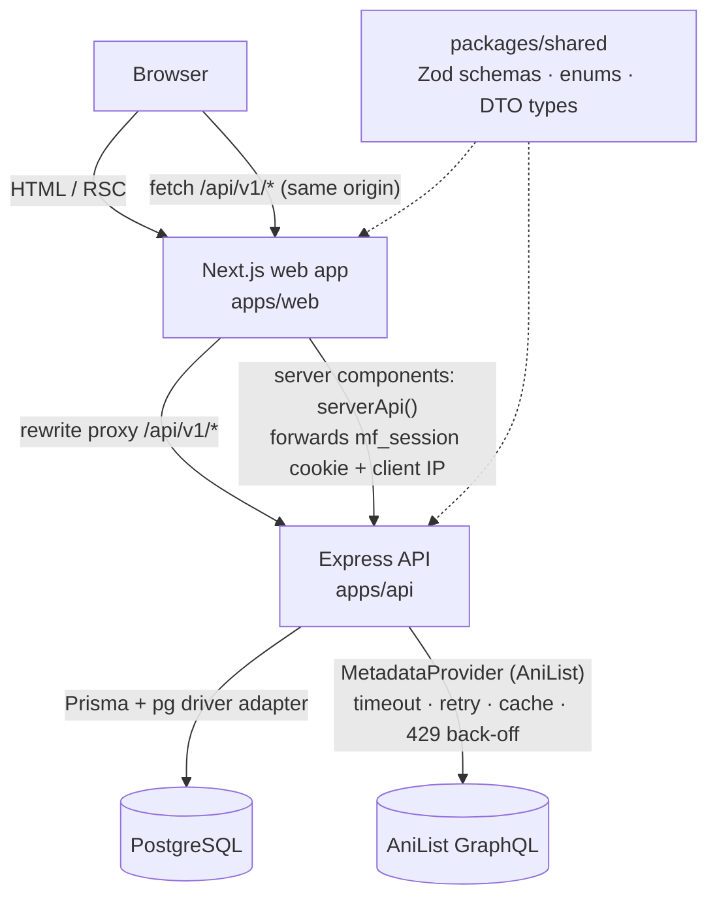

# MangaForEver architecture

## System overview



- **One origin for the browser.** All client-side calls go to `/api/v1` on the web origin and Next.js proxies them to the API. The session cookie is therefore first-party (`HttpOnly; SameSite=Lax; Secure` in production) even when the web app runs on Vercel and the API on Render.
- **Server rendering with the user's session.** Server components call the API directly through `serverApi()`, forwarding only the `mf_session` cookie, the visitor's IP (so per-IP limits apply to them) and an optional `INTERNAL_API_TOKEN`.
- **Shared contracts.** `@mangaforever/shared` holds every request schema (Zod) and response type. The API validates with the same schemas the forms use, so client and server rules can't drift.

## API layering

```
routes/index.ts          route table, middleware per route (auth, role, rate limits)
  └ controllers/*.ts     parse/validate input, call services, shape HTTP responses
      └ services/*.ts    business rules, ownership checks, transactions
          └ lib/prisma.ts  Prisma client (parameterised queries only)
providers/               MetadataProvider interface, AniList implementation, importer
middleware/              loadSession, requireAuth, requireRole, validate, originCheck, rate limits, errors
```

Request pipeline: `pino-http` → Helmet → CORS (allow-list) → compression → JSON body (100 kB) → cookie parser → global rate limit → **origin check** (state-changing requests must come from an allowed Origin and send JSON) → **session loader** → route-level auth/role/limits → controller → service → central error handler (no stack traces or internals in responses; Prisma unique/not-found errors map to 409/404).

## Authentication & authorization

- Passwords hashed with **bcrypt (cost 12)**. Login compares against a dummy hash when the account doesn't exist, and returns the same message for unknown user and wrong password.
- Sessions are random 256-bit tokens; only their **SHA-256 hash** is stored (`Session.tokenHash`). Sessions slide (refreshed at most hourly), expire after `SESSION_TTL_DAYS`, are swept hourly, and are revoked on password reset/change and suspension.
- Password reset tokens are hashed, single-use, expire after one hour, and the endpoint never reveals whether an email exists.
- **Roles:** `USER < MODERATOR < ADMIN`, enforced by `requireRole()` on the server. Moderators can only reach report/visibility routes; everything else under `/admin` requires ADMIN.
- **Ownership:** every user-data query is scoped by `userId` from the session (e.g. `findFirst({ where: { id, userId } })`), so another user's IDs return 404 rather than leaking existence. Public profile endpoints honour privacy settings and never return notes, history or emails.
- **Rate limits:** failed logins 10 / 15 min / IP; registration 10 / h; password reset 5 / h; search 120 / min; reviews & reports 20 / h per user; writes 120 / min per user; global 600 / min per IP (SSR traffic with `INTERNAL_API_TOKEN` exempt).

## Data model

```mermaid
erDiagram
  User ||--o{ Session : has
  User ||--o| UserPreference : has
  User ||--o{ LibraryEntry : tracks
  User ||--o{ Favorite : favorites
  User ||--o{ Rating : rates
  User ||--o{ Review : writes
  User ||--o{ ReviewHelpfulVote : votes
  User ||--o{ ReviewReport : files
  User ||--o{ ReadingHistory : views
  User ||--o{ ReadingActivity : logs
  User ||--o{ SearchHistory : searches
  User ||--o{ Follow : follows
  User ||--o{ AdminAuditLog : performs
  MangaSeries ||--o{ SeriesGenre : ""
  Genre ||--o{ SeriesGenre : ""
  MangaSeries ||--o{ SeriesTag : ""
  Tag ||--o{ SeriesTag : ""
  MangaSeries ||--o{ SeriesCreator : ""
  Creator ||--o{ SeriesCreator : "STORY / ART"
  MangaSeries ||--o{ ChapterMetadata : "provider data only"
  MangaSeries ||--o{ LibraryEntry : ""
  MangaSeries ||--o{ Favorite : ""
  MangaSeries ||--o{ Rating : ""
  MangaSeries ||--o{ Review : ""
  Review ||--o{ ReviewHelpfulVote : ""
  Review ||--o{ ReviewReport : ""
  MangaSeries ||--o| FeaturedSeries : ""
  SeasonalCollection ||--o{ SeasonalCollectionItem : ""
  MangaSeries ||--o{ SeasonalCollectionItem : ""
```



Key decisions:

- **Author/Artist → one `Creator` table** with the role on `SeriesCreator` (`STORY`, `ART`). One person can be both.
- **Personal score = `Rating`.** The library's score field writes to the same `Rating` row the series page uses, so there is one source of truth.
- **Denormalised community stats** (`ratingAvg`, `ratingCount`, `favoriteCount`, `libraryCount`, `reviewCount`, `popularityScore`) are **recomputed from the stored rows** after every relevant write (`recomputeSeriesStats`), never incremented blindly.
- **`metadataUpdatedAt`** changes only when catalog metadata changes, so counter updates don't pollute “Latest updates”.
- **`searchText`** concatenates titles, alt/native titles, creators, genres, tags and type words; it is rebuilt on every catalog write and indexed with `gin_trgm_ops`. Full-text ranking uses `to_tsvector('simple', …)` at query time.
- **JSON columns** only where the shape is genuinely open: `localizedTitles` (language → title), `externalUrls`, `ReadingActivity.data`, `AdminAuditLog.details`.
- **Archive, don't delete.** Admin "delete" archives by default so members' libraries and reviews survive; hard delete is explicit.
- Discussion threads/comments can later hang off `MangaSeries` and `User` without touching existing tables.

## Rankings

| Ranking | Source | Formula |
| --- | --- | --- |
| Popular / Top 10 | community | `library × 1 + favorites × 2 + ratings × 1.5 + reviews × 2` |
| Top rated | community | Bayesian average `(v/(v+m))·R + (m/(v+m))·C`, `m = 5`, `C` = site-wide mean, minimum 3 ratings |
| Trending | community | same weights as popular, counted over the last 30 days |
| Most reviewed / favorited | community | visible review count / favorite count |
| AniList popularity | external | AniList's member count; imported titles only |

Every ranking response includes its explanation, its source (`community`/`external`) and `includesDemoActivity` when seeded demo accounts contribute.

## Recommendation engine

`services/recommendation/scoring.ts` is a **transparent rules-based model** (not ML):

1. **Taste profile** — per-genre, per-tag, per-type and per-creator weights accumulated from:
   preferred genres (+3), favorites (+2.5), reading status (reading +1.2, completed +1.5, plan +0.6, on hold +0.4, dropped −1.0), ratings (`(score − 6) × 0.5`, so 10 → +2, 3 → −1.5), viewed series (+0.3), searches that name a genre (+0.6). Creators are remembered from strongly-liked series.
2. **Candidate score** for every series not in the library and not dismissed:
   `3.0·genre + 1.5·tag + 0.8·type + 1.2·creator + 0.9·quality + 0.4·popularity + 0.15·jitter`
   Affinities are normalised (genre/tag sums divided by √n so long genre lists don't win); quality is the Bayesian-shrunk member rating; popularity is log-scaled; jitter is a deterministic hash of user + day + refresh token, so "Refresh" reshuffles near-ties without randomising everything.
3. **Diversity re-rank** — greedy selection that subtracts `0.35 ×` the number of already-picked series sharing the candidate's primary genre.
4. **Reasons** come from the strongest contributions: "From *creator*, who also made *title*", "Because you like *genre*", "Features *tag*…", "You read a lot of manhwa", "Highly rated by MangaForEver members".

Extra shelves: **Because you read X** (Jaccard similarity on genres 0.5 / tags 0.3 + shared creator 0.25 + same type 0.1 to the latest highly-rated or active series), **Similar to your favorites**, **Popular in your top genre**. Users below a minimum signal strength (and signed-out visitors) get **Popular**, **Highly rated** and **Editor's picks** instead.

## External metadata (AniList)

- `MetadataProvider` interface (`search`, `getById`, `popular`) with a registry, so another licensed source can be added without touching services.
- AniList client: 8 s timeout via `AbortSignal.timeout`, 2 retries with exponential back-off for network/5xx errors, honours `429 Retry-After` by pausing all calls, 10-minute in-memory cache, adult titles excluded.
- Mapping: country → content type (JP manga, KR manhwa, CN/TW/HK manhua), status mapping, HTML stripped from descriptions, score /100 → /10, spoiler/adult tags dropped, staff roles → STORY/ART, fuzzy dates only become dates when the month is known. Fields AniList doesn't provide (publisher, demographic) stay `null`.
- Imports upsert on `(externalProvider, externalId)`; `lastSyncedAt` records provenance; community statistics are never touched.
- Provider failures surface as `503 SERVICE_UNAVAILABLE` with a readable message; the local catalog keeps working.

## Frontend

- Server components fetch data (personalised via the forwarded cookie); interactive pieces are small client components (search box, library editor, rating control, review form, filters, admin tools).
- Mutations call the API from the client and then `router.refresh()` so server-rendered numbers update.
- Design tokens are CSS variables (dark default, light override) mapped into Tailwind's theme. Display type: Bricolage Grotesque; body: Figtree (self-hosted via Fontsource).
- Sample titles get a generated typographic cover (deterministic palette and shape from the title) instead of borrowed artwork; provider covers go through `next/image` with lazy loading.
- All user-generated text is rendered as React text nodes — no `dangerouslySetInnerHTML` anywhere.
